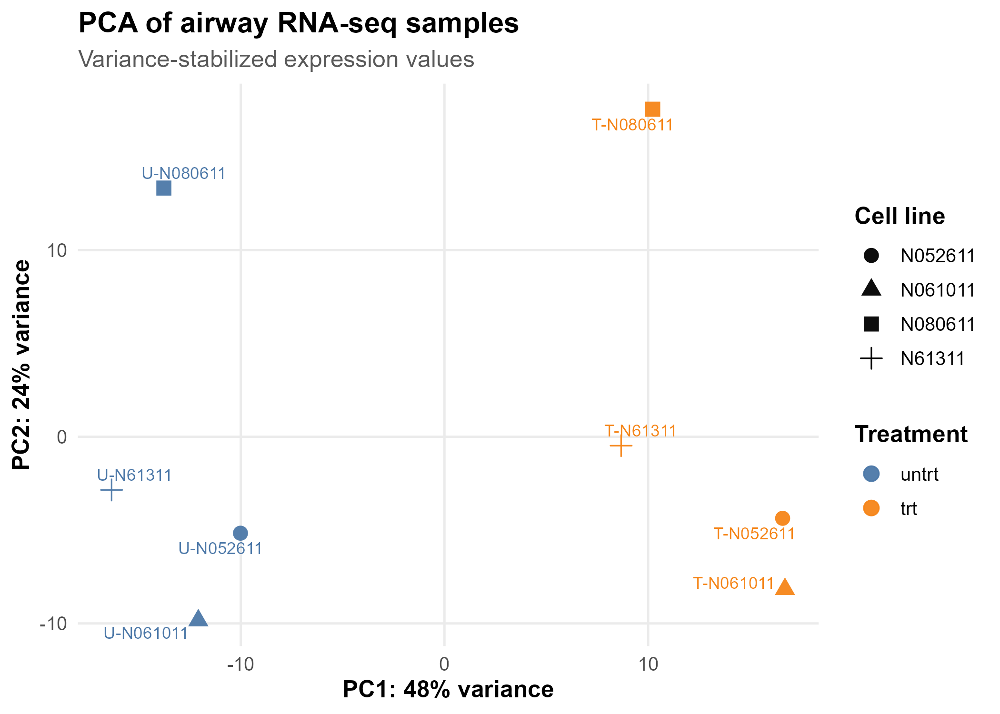
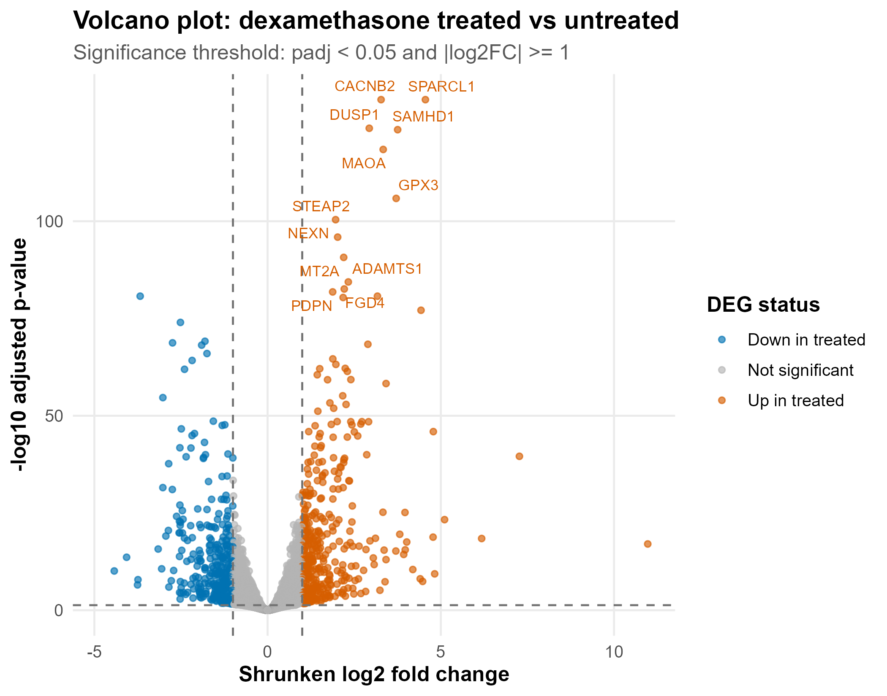

# RNA-seq Workflow

A reproducible RNA-seq analysis workflow demonstrating differential expression analysis, publication-ready visualizations, and structured result reporting.

## What This Project Shows

- RNA-seq differential expression workflow
- PCA, heatmap, and volcano plot generation
- Organized result tables and figures
- Short analysis report structure
- Reproducible scripting practice

## Example Outputs

- PCA plot: [`results/plots/pca.png`](results/plots/pca.png)
- Sample distance heatmap: [`results/plots/sample_distance_heatmap.png`](results/plots/sample_distance_heatmap.png)
- Top DEG heatmap: [`results/plots/top_deg_heatmap.png`](results/plots/top_deg_heatmap.png)
- Volcano plot: [`results/plots/volcano.png`](results/plots/volcano.png)
- Differential expression results table: [`results/tables/deg_results.csv`](results/tables/deg_results.csv)
- Short analysis report: [`reports/summary_report.md`](reports/summary_report.md)





The project is designed as a clean proof-of-work repository for an end-to-end RNA-seq DEG workflow: raw count data, metadata, QC, DESeq2 analysis, PCA, heatmaps, volcano plot, DEG tables, and a short interpretation report.

## Dataset

This template uses the Bioconductor `airway` experiment package. The dataset contains RNA-seq read counts from human airway smooth muscle cell lines treated with dexamethasone and matched untreated controls.

Primary analysis contrast:

```text
dexamethasone treated vs untreated
```

The DESeq2 design controls for cell line:

```r
design = ~ cell + dex
```

## Outputs

| Output | Description |
| --- | --- |
| `data/raw/airway_counts.csv` | Raw gene count matrix exported from the airway package |
| `data/raw/airway_metadata.csv` | Sample metadata |
| `data/processed/airway_counts_filtered.csv` | Count matrix after low-count filtering |
| `results/tables/qc_summary.csv` | Sample and filtering summary |
| `results/tables/deg_results.csv` | Full DESeq2 result table |
| `results/tables/significant_deg_results.csv` | DEGs with `padj < 0.05` and `abs(log2FoldChange) >= 1` |
| `results/tables/normalized_counts.csv` | DESeq2-normalized counts |
| `results/plots/pca.png` | PCA plot using variance-stabilized expression |
| `results/plots/sample_distance_heatmap.png` | Sample clustering heatmap |
| `results/plots/top_deg_heatmap.png` | Heatmap of top 40 DE genes |
| `results/plots/volcano.png` | Volcano plot |
| `reports/summary_report.md` | Short client-facing interpretation report |

PDF versions of the plots are also written for publication workflows.

## Requirements

- R 4.4+ recommended
- Internet access for first-time package installation
- R packages:
  - CRAN: `ggplot2`, `ggrepel`, `pheatmap`, `dplyr`, `readr`, `tibble`, `RColorBrewer`
  - Bioconductor: `DESeq2`, `airway`, `SummarizedExperiment`, `AnnotationDbi`, `org.Hs.eg.db`, `apeglm`

The setup script installs missing packages automatically.

On Windows, see `INSTALL_WINDOWS.md` if `Rscript` is not found.

## Run

From the project root:

```powershell
Rscript run_analysis.R
```

Individual steps can also be run in order:

```powershell
Rscript scripts/00_setup.R
Rscript scripts/01_download_or_prepare_data.R
Rscript scripts/02_qc.R
Rscript scripts/03_deseq2_deg.R
Rscript scripts/04_make_plots.R
Rscript scripts/05_write_report.R
```

## Methods Summary

1. Import raw count data and sample metadata from Bioconductor `airway`.
2. Filter low-count genes: keep genes with count >= 10 in at least 4 samples.
3. Fit DESeq2 with `~ cell + dex`.
4. Shrink log2 fold changes with `apeglm`.
5. Mark significant DEGs using:

```text
padj < 0.05 and abs(log2FoldChange) >= 1
```

6. Use variance-stabilized values for PCA and heatmaps.
7. Export clean CSV tables, PNG/PDF plots, and a short report.

## Source Notes

- DESeq2 expects raw count data and performs its own normalization through size factors.
- PCA and heatmaps use variance-stabilized expression values because RNA-seq count variance depends on the mean.
- The airway dataset is a compact public example suitable for proving the workflow, not a substitute for project-specific experimental design review.
